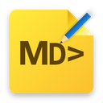
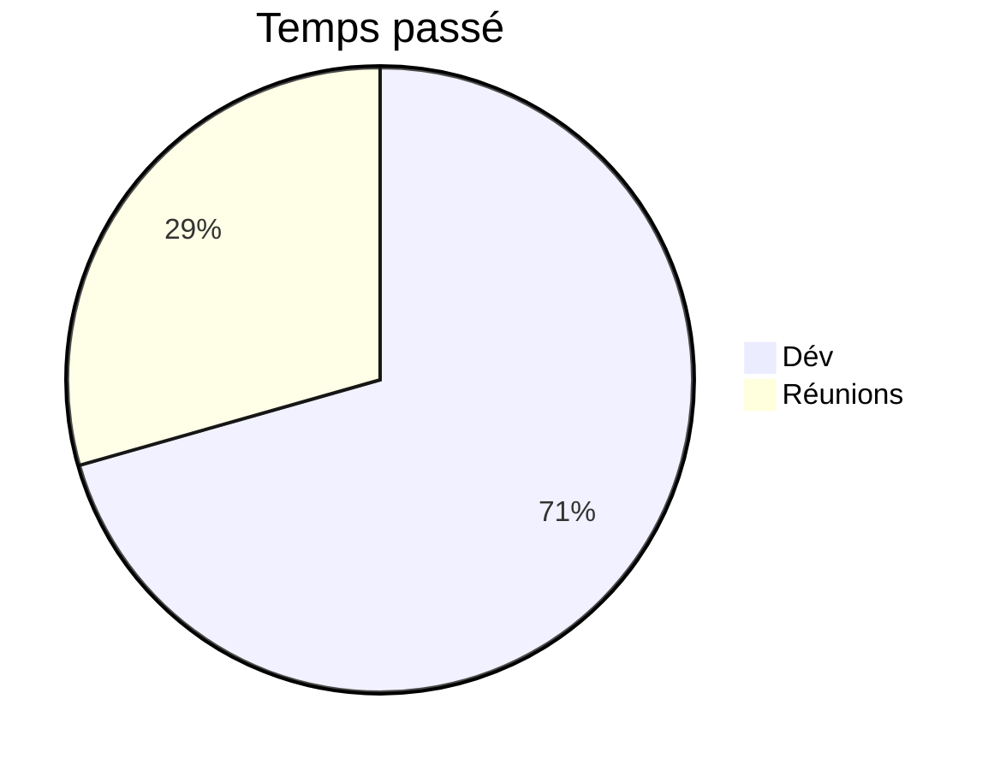

<p align="center">
  
</p>

<h1 align="center">myMDnotepad</h1>

<p align="center">
  <a href="https://github.com/Nyco87/myMDnotepad/actions/workflows/ci.yml"></a>
  <a href="https://codecov.io/gh/Nyco87/myMDnotepad"></a>
  <a href="https://github.com/Nyco87/myMDnotepad/security/code-scanning"></a>
  
  
  
  
  
  
  
</p>

<p align="center">
  Éditeur de notes Markdown « tel que vous le lisez », portable, pour Windows 11.
</p>

> **English summary** — myMDnotepad is a portable WYSIWYG Markdown note-taking app for Windows 11. You write directly in the rendered view (no visible `#`, `>` or `|`), and every note is saved as a clean, human-readable `.md` file in a folder of your choice. Single `.exe`, no installer. Dark Fluent design with acrylic and your Windows accent colour. Tables, task lists, GitHub alerts, `==highlight==`, Mermaid diagrams built with a visual workshop, a `/` command menu, tabs, and a French/English interface.

---

## Pourquoi

Écrire du Markdown dans un éditeur de code oblige à jongler entre la syntaxe et un aperçu dans un autre onglet. myMDnotepad supprime cet aller-retour : on écrit directement dans le rendu, et le fichier reste un vrai `.md` propre, lisible partout (VS Code, GitHub, Obsidian…).

## Fonctionnalités

- **Édition visuelle** : titres, gras, italique, barré, `==surligné==`, code, citations, listes, cases à cocher, liens, images, séparateurs — sans jamais voir la syntaxe.
- **Raccourcis Markdown à la frappe** : `## ` devient un titre, `> ` une citation, `- ` une liste, `---` + espace un séparateur, etc.
- **Menu `/`** : tapez `/` puis quelques lettres pour insérer ou transformer un bloc (`/tab`, `/titre`, `/note`, `/schéma`…).
- **Tableaux** : création en un clic, ajout de lignes/colonnes n'importe où, alignement, suppression.
- **Blocs d'alerte GitHub** : Note, Astuce, Important, Attention, Danger (`> [!WARNING]`).
- **Schémas Mermaid** : affichés comme dessins ; un **atelier** permet d'en créer sans écrire de code (camembert, Gantt, flux, diagramme d'états).
- **Images** : collez une capture (Ctrl+V) ; elle est enregistrée dans un dossier `images/` à côté de la note et suit la note si vous la déplacez ou la renommez.
- **Arborescence et onglets** : vos dossiers et notes sur le côté (panneau redimensionnable et repliable), plusieurs notes ouvertes en onglets, session restaurée au lancement.
- **Enregistrement automatique** sûr : aucune perte de données, détection des modifications faites ailleurs (OneDrive, VS Code…) avec copie « conflit » si nécessaire, suppression vers la Corbeille uniquement.
- **Markdown « propre »** : le fichier est toujours réécrit de la même façon (tableaux alignés, une syntaxe cohérente) ; le Markdown que l'éditeur ne sait pas afficher est conservé à l'identique.
- **Apparence Windows 11** : thème sombre Fluent, effet acrylique (transparence réglable), couleur d'accent de Windows suivie en direct.
- **Interface en français ou en anglais**.

## Installation

1. Téléchargez `mymdnotepad.exe` (ou construisez-le, voir plus bas).
2. Placez-le où vous voulez et lancez-le — **aucune installation**.
3. Au premier lancement, choisissez le dossier de vos notes (un dossier OneDrive les synchronise automatiquement).

> L'exécutable n'est pas signé : Windows SmartScreen peut afficher « Windows a protégé votre ordinateur ». Cliquez sur **Informations complémentaires → Exécuter quand même**.

Prérequis : Windows 11 (le moteur WebView2 est déjà présent).

## Réglages

L'onglet **Réglages** (icône ⚙) permet de changer le dossier des notes, l'emplacement du fichier de réglages, la transparence de la fenêtre et la langue.

Le fichier de réglages est cherché dans cet ordre :

1. `mymdnotepad.settings.json` à côté de l'exe (**mode portable**, par ex. sur une clé USB) ;
2. un emplacement personnalisé choisi via « Déplacer… » (par ex. OneDrive) ;
3. par défaut : `%APPDATA%\myMDnotepad\mymdnotepad.settings.json`.

## Raccourcis clavier

| Action | Raccourci |
|---|---|
| Nouvelle note | Ctrl+N |
| Fermer l'onglet / onglet suivant | Ctrl+W / Ctrl+Tab |
| Gras / italique / barré / surligné / code | Ctrl+B / Ctrl+I / Ctrl+Shift+X / Ctrl+Shift+H / Ctrl+E |
| Titre 1 à 6 / paragraphe | Ctrl+1…6 / Ctrl+0 |
| Cocher / décocher une tâche | Ctrl+Entrée |
| Augmenter / réduire le retrait d'une liste | Tab / Maj+Tab |
| Cellule suivante / précédente (tableau) | Tab / Maj+Tab |
| Ouvrir un lien | Ctrl+clic |
| Replier le panneau latéral | Ctrl+\ |
| Annuler / rétablir | Ctrl+Z / Ctrl+Y |
| Menu d'insertion | `/` |

## Syntaxe prise en charge

CommonMark + GFM (tableaux, cases à cocher, barré), plus :

~~~markdown
==texte surligné==

> [!TIP]
> Les alertes GitHub : NOTE, TIP, IMPORTANT, WARNING, CAUTION.


~~~

## Construire depuis les sources

Prérequis : [Node.js](https://nodejs.org/) 20+, [Rust](https://rustup.rs/) (toolchain `stable-msvc`) et les Build Tools Visual Studio (C++).

```bash
npm install
npm run tauri dev                 # lancement en développement
npm test                          # tests de l'interface (Vitest)
cd src-tauri && cargo test        # tests Rust
npx tauri build --no-bundle       # exe unique : src-tauri/target/release/mymdnotepad.exe
```

Technologies : [Tauri 2](https://tauri.app/) (Rust), TypeScript + Vite, [ProseMirror](https://prosemirror.net/), [markdown-it](https://github.com/markdown-it/markdown-it), [Mermaid](https://mermaid.js.org/).

## Licence

[MIT](LICENSE) © 2026 Nicolas Morellet
